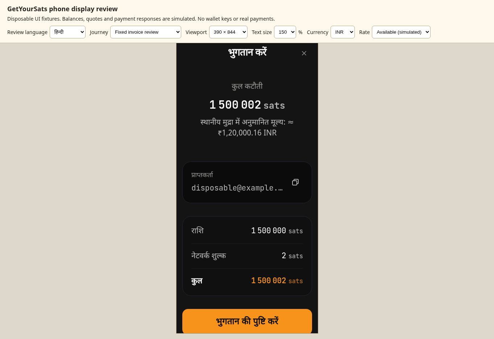
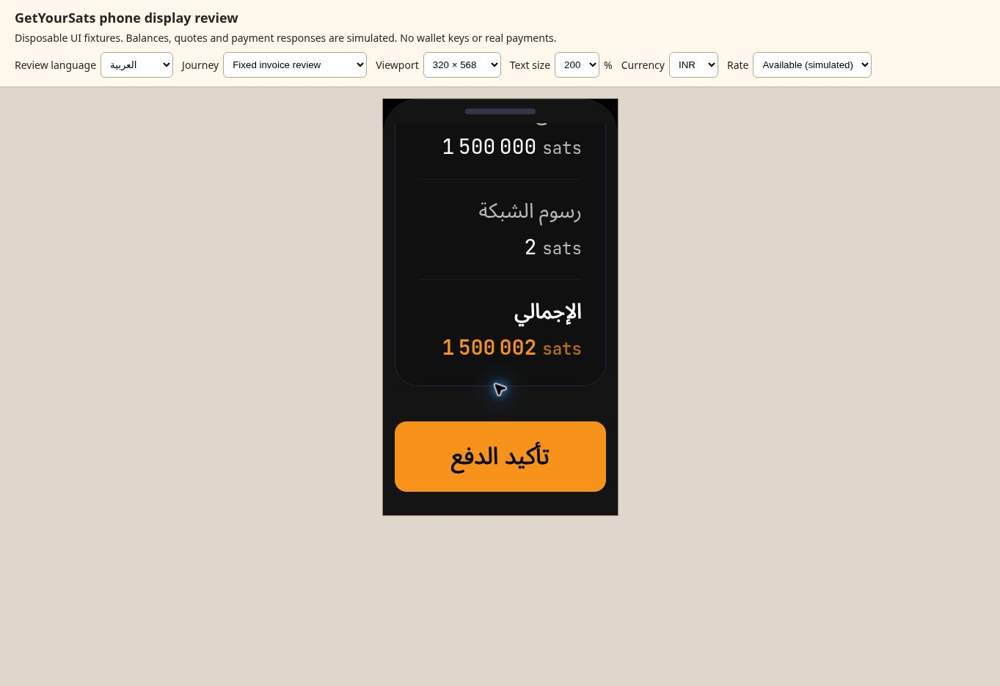

# Android display and payment-language follow-up

Reviewed 27 October 2026. Companion to the [browser journey review](browser-language-journey-review-2026-10-27.md) and PR #58.

## Decision and scope

The reported symptoms have application-level causes. They should not be dismissed as limitations of an inexpensive Android phone. The earlier journey review covered mixed-language payment states, receiving controls and numeric conventions (B03, B07 and B11). This follow-up adds explicit regressions for the missing fiat estimate, the stale personalization hint and enlarged-text reflow.

**No physical Tecno Spark / HiOS 13 device was available.** Browser checks use real application components with a constrained iframe viewport and a 100%, 150% or 200% root font size. This is not Android system magnification, Chrome accessibility scaling, device emulation, a native build or a low-end CPU benchmark. No production release, merge, wallet restoration, recovery phrase, signing key or funded payment was used.

The implementation was tested at local source commit `aa225dbe187feb64dbb3ac3b4a3874e75c47f739`, tree `2668265c1f648616e48228bc2fee97bfbf13f38d`. Its ancestry includes reviewed PR #58 head `7dbd306662efcdd369416c93a0a5953dc4361c50` and main `07ddf16068cc5bd7ed09397e221800ad7b12d767` through merge `786d6f2fa390d8617a21d27c09ea5551340c8e80`. The documentation/evidence commit does not change the implementation. Production remains separate.

Remote source commit `fe89bb02881627cc8e19e2a5cd0bb047c749f2d8` has the identical verified tree `2668265c1f648616e48228bc2fee97bfbf13f38d`. It preserves both remote parent histories; the different commit ID reflects publication metadata, not a source difference.

## Findings and implementation

Priority describes usability and payment comprehension, not a newly proven signing vulnerability. Three findings are High priority; none is classified as Critical here.

| ID | Priority | Confirmed source or browser cause | Patch and remaining boundary |
|---|---|---|---|
| A01 | Medium | Market formatting inherited the browser locale; the balance header used different grouping and decimal rules. Selecting INR did not consistently select Indian grouping. The exact reported HiOS separators were not independently observed. | `utils/formatFiat.ts` centralizes fiat display for the balance header, Market and new estimates. INR uses `en-IN` with Latin monetary digits in every language, for example `₹12,34,567.89`; other currencies use the selected app language. Display formatting never changes atomic payment amounts. Other legacy monetary surfaces still need the broader B11 pass. |
| A02 | High | `ConfirmStep` displayed exact sats and fees but no selected-fiat equivalent. Fixed BOLT11 invoice reviews use this component after scan input is explicitly reviewed. | `FiatEstimate` displays an approximate total including the prepared fee. Amount entry, LNURL amounts, created invoices and non-token payment celebrations also receive estimates. Missing, invalid or older-than-two-minute rates produce an explanatory message instead of zero or a stale conversion. This is indicative valuation, not a guaranteed exchange quote or replacement for sats/fees. |
| A03 | High | Processing, ordinary success/failure, receive confirmation and shared copy controls contained hard-coded English. Authentication failure could also use the success title. | A typed 45-key catalog covers all ten app languages for these states. Authentication failure has its own title. Unknown-payment handling remains distinct; no automatic resend was introduced. Full Send/Receive localization remains incomplete: cross-chain details, some method titles, amount hints, provider errors and child dialogs still need B02/B07 work. |
| A04 | Low | `LightningAddressDisplay` rendered setup guidance regardless of the connected wallet's verified personal address. | Receive compares its displayed address to `preferredLightningAddress` from the current wallet context. A matching address gets ready-to-receive guidance; a default/unconfigured address retains setup guidance. The change does not infer ownership from an address suffix or register a new address. |
| A05 | High | At 320 CSS px and 200% text, the title truncated, a large sats total split across numeric groups, receive tabs exceeded their available width and rem-scaled dock buttons outgrew their fixed-height container. | Shared dialog titles wrap, close/back controls retain fixed 44px targets, fee rows wrap between labels and values, and grouped sats digits stay together with left-to-right isolation. Narrow sheets use fixed horizontal padding; the QR has its own grid row and the network controls no longer grow out of their container. Result/celebration text can wrap and scroll. Exact total, fee and confirmation remain reachable. |

Brand and protocol names remain unchanged: GetYourSats, Bitcoin, Lightning, sats, BTC, USDT and USDC. Translation coverage is machine-assisted and does not establish native-speaker certification.

## Verification

| Check | Result |
|---|---|
| `npm test` | 1,144 tests in 120 files passed on the source commit above. Disposable fixtures and mocked SDK responses only. |
| `npx vitest run src/features/send/scanHandoff.test.tsx` | 11 passed. The added test reviews a synthetic fixed Lightning QR, checks recipient, exact total and approximate USD, and asserts no SDK send before confirmation. |
| `npm run lint` | Zero errors; eight pre-existing warnings in other/previously warned code. |
| `npm run build` | TypeScript and production bundle passed. Existing mixed static/dynamic `passkeyService` import and node-polyfill build warnings remain. |
| `git diff --check` | Passed. |
| Fixture exclusion | No Android fixture entry or its forbidden-send sentinel in the production bundle. |
| Browser observations | [61 recorded observations](android-display-2026-10-27/observations.json), including a five-surface matrix across all ten languages at 320px/200% text. The sampled headings, controls and fiat paragraphs stayed within the horizontal viewport. |
| Other browser cases | Missing rate, INR/USD selection, amount entry, configured/default receive guidance, manual scroll to the Arabic confirmation button, and extra 360, 390, 768 and 1,366px samples. |

The full test output includes existing Headless UI/snap-point warnings and a simulated account-removal iframe fetch to an absent localhost server. These did not fail the suite. A first new QR test used an incorrect mock invoice shape; it was corrected to match the installed parser representation before the final run. A short browser selector timeout during frame replacement was re-observed successfully; it is not recorded as a device failure or a passing latency target.

The fixture at `e2e/fixtures/android-payment-review.html` exposes explicit language, journey, viewport, text-size, currency and missing-rate controls. It uses no wallet keys and throws on `sendPayment`. Its confirmation action only closes the preview. Browser observations are review evidence, not settlement tests or an accessibility certification. The existing five-second automatic celebration dismissal remains a separate accessibility follow-up.

### Hindi review, 390px and 150% text

The fixture has a 1,500,000-sat payment, a 2-sat fee and a synthetic INR rate. The approximate total is `₹1,20,000.16`, beside the authoritative `1 500 002 sats` total.

### Arabic review, 320px and 200% text

After scrolling the sheet, the fee, full total and confirmation action remain readable and reachable. Numeric values retain left-to-right order within the Arabic layout.

## Performance boundaries

The new estimate reuses `FiatDataProvider`; it makes no additional network requests. Its clock uses an initial refresh and one expiry timer per fetched rate, plus existing preference/visibility events, instead of continuous polling. Dismissal removes its timers and listeners. Fiat formatters are cached with a bounded 48-entry cache. Tabs use color transitions and existing reduced-motion rules remain in place.

These are bounded code changes, not measured frame-rate, memory, battery or startup improvements on Tecno hardware. The large-font browser sample checks content usability. Cold start, font download, camera decoding, keyboard behavior and animation frame pacing still need measurements on the target device.

## Physical-device acceptance and release handoff

1. Record the exact Tecno model, Android version, HiOS version, RAM, Chrome/Android System WebView versions, and whether the app is a browser tab, installed PWA or native build. Record the wallet release identifier. A redacted screenshot or short recording is enough; no recovery phrase is needed.
2. Test system font size and display size independently at default and maximum, then Chrome text scaling and Android magnification. Repeat portrait/landscape and keyboard open/closed. Check the close/back controls, complete recipient, sats, fee, fiat estimate and confirmation button without horizontal panning.
3. With disposable test data, select INR in each supported app language and verify Indian grouping and two decimal places. Test unavailable rates and returning from the background after the quote becomes stale. Verify that changes to a display preference never modify the payment request.
4. Scan a fixed invoice and an amountless Lightning request on the actual camera. Verify the exact sats and approximate selected fiat on review. Verify positive, failure, pending and unknown states in the chosen language. Do not use a real payment just to inspect these labels; actual settlement is a separately authorized test.
5. Open Receive with a verified personal address, reopen it after backgrounding and confirm the hint is correct. Repeat with a disposable unconfigured wallet to verify the setup hint remains. Check QR visibility and scanning after enlarged text and rotation.
6. Run PR checks and review the UI-only changes separately from the unresolved custody/security release work. This patch does not clear the security release gates. Complete the remaining B02/B07 translations before claiming fully localized Send/Receive journeys.

Deploy using the existing release/version and service-worker process once the applicable checks pass. No custody migration is needed for these display changes. Rollback is to the prior verified UI release and service-worker assets; do not clear browser wallet storage or replace a wallet as a display rollback. Keep the device report and regression evidence attached to this register.

Relevant references: [W3C Resize Text](https://www.w3.org/WAI/WCAG22/Understanding/resize-text.html), [W3C Reflow](https://www.w3.org/WAI/WCAG22/Understanding/reflow.html), and [MDN Intl.NumberFormat](https://developer.mozilla.org/en-US/docs/Web/JavaScript/Reference/Global_Objects/Intl/NumberFormat/NumberFormat). Passing a few samples does not establish full conformance to these criteria.
