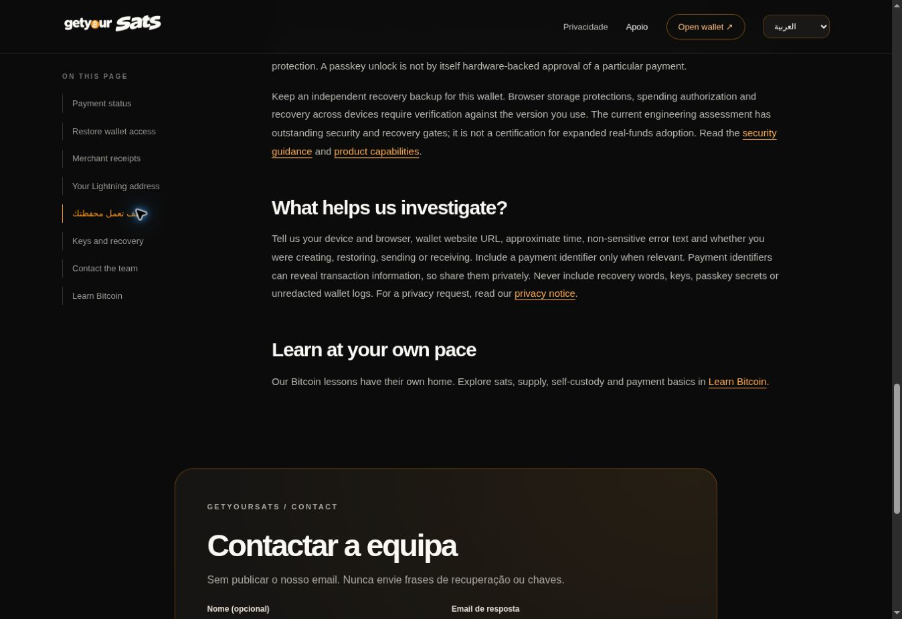
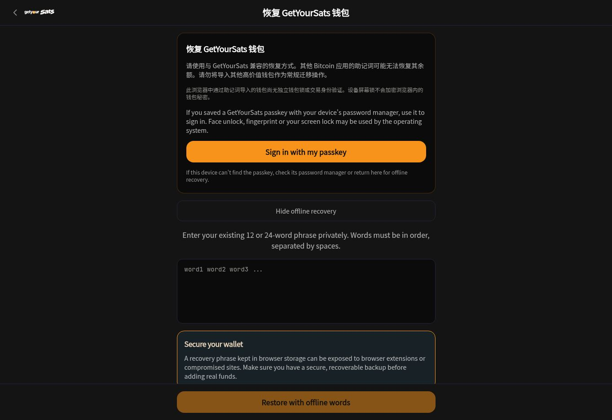
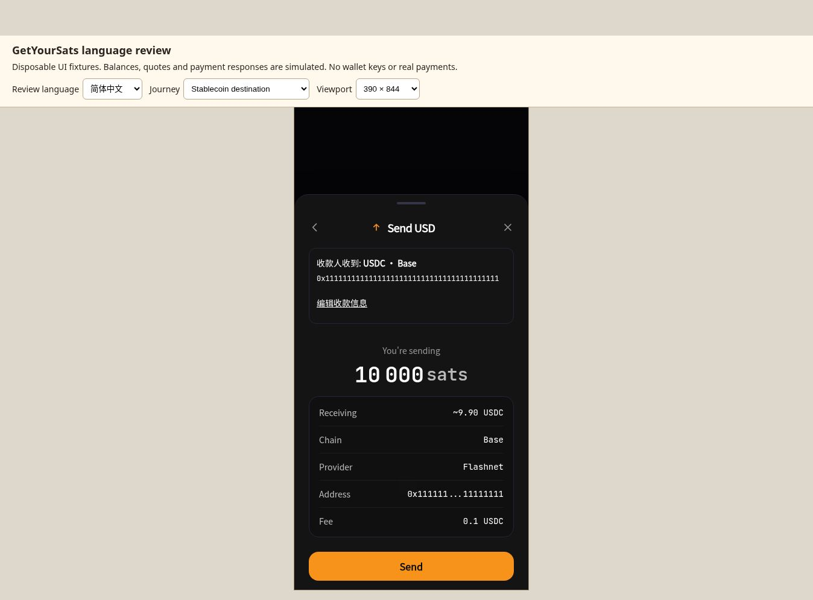

# GetYourSats browser language and journey review

Reviewed 27 October 2026. Companion to [the source localization review](localization-review-2026-10-27.md) and [PR #58](https://github.com/Bradvani/getyoursats-wallet/pull/58).

**Android follow-up:** [The Tecno/HiOS display report and implementation evidence](android-display-review-2026-10-27.md) now tracks INR grouping, missing scanned-payment fiat estimates, localized payment states, configured-address guidance and 200% text reflow. It advances B03, B07 and B11 without marking the wider translation work or physical-device testing complete.

## Decision

The product does **not yet provide ten complete localized journeys**. The largest problem is a language changing between steps: a translated menu leads to an English security screen, or a translated recipient screen leads to an English payment approval. These are comprehension defects at the points where users make consequential decisions.

This review used the browser directly, including language changes, navigation, expanded instructions, amount entry, validation errors, payment reviews and cancellation. It goes beyond counting translation keys. It is an AI-assisted linguistic and usability assessment, not a claim of native-speaker credentials or independent certification in ten languages.

The existing orange/cream identity, compact language selector, translated LNURL balance/fee review, uncertain-payment guidance and wallet-removal warning provide useful foundations. Preserve them while completing whole journeys.

## Evidence and boundaries

| Environment | Version and evidence |
|---|---|
| Live website and wallet | Vercel READY deployments at `13f7ff73f89ccde9c633cde981ce306c285a0942`; website `dpl_23DNSpbVHc5ibQmjByhaxKW6qyzS`, wallet `dpl_949h8AJAod5DxvCFUHk9GWeeEvY4` |
| Candidate UI fixtures | Local base `213b235765c6e18fe79a463e28e594eaee30f17f`, identical tree to remote PR head `a258d21494bb7ae2b2dd76f2da8f172d891247ea`; accompanying QA harness and copy corrections included |
| Exact final patch | The Git commit containing this document records the final source, copy changes, fixtures and evidence together |
| Browser evidence | [Structured observations](browser-language-2026-10-27/evidence.json), with surface, language, snapshots and layout measurements; observations are not automated test passes |
| Fixture safety | Actual application components with disposable UI data and mocked SDK responses. The review wrapper explicitly labels all balances, quotes and outcomes as simulated |

No supplied recovery phrase was entered, stored in artifacts or used to connect a wallet. No real payment was submitted, no contact request was sent and no wallet was removed. This review neither proves settlement nor revises the independent security release decision. Passkey prompts, restoration of the same funded wallet, native iOS/Android builds, installed-PWA operating-system behavior and external checkout were not tested.

The POS fixture could not create its simulated invoice on the HTTP preview origin because `crypto.randomUUID` was unavailable there. This is an environment limitation, not evidence that production POS fails. A legacy inherited browser tab containing a synthetic claim example was excluded from production evidence. Empty snapshots during frame replacement were discarded and relevant payment states rechecked.

## Browser coverage

All ten languages were selected individually: English, Hindi, Spanish, Portuguese, Japanese, Thai, Vietnamese, Tamil, Arabic and Simplified Chinese (`zh-CN`). Simplified Chinese is a written locale; this does not establish Traditional Chinese support.

| Journey | Live production | Isolated candidate components | Result |
|---|---|---|---|
| Landing and restore entry | All ten; empty recovery form expanded in Chinese | — | Localized headings, but recovery actions/instructions still English |
| Support | All ten options, including switching from Portuguese to the newer languages | — | Mixed languages and stale document language reproduced |
| Learn | All four offered languages; seven lessons expanded | — | Six advertised wallet languages absent; navigation partly English |
| Privacy | All four offered production languages | Complete candidate notice in all ten | Production summary-only translations; candidate full notice renders |
| Account-removal instructions | Opened from public navigation | — | English-only; production uses obsolete “Log Out” label |
| Settings and phone menu | — | All ten | Menu translates; security/account/advanced sections remain English |
| LNURL amount, insufficient balance and review | — | All ten | Available balance and fee distinction translate; review arithmetic consistent with fixture |
| Stablecoin destination, amount and quote | — | All ten | Asset/network selection translates; amount/approval revert to English |
| Processing, success, failure, unknown result | — | Each state in all ten | Ordinary outcomes English; unknown-result warning translated |
| Lightning receive and stablecoin amount entry | — | All ten | Mixed-language receiving instructions and controls |
| History and POS entry | — | All ten | Headings translate; search, filters, sales entry and many actions English |
| Remove-wallet warning | — | All ten, cancelled every time | Warning and recovery checkbox translate; Cancel remains English |
| Settings layout | — | Japanese, Tamil, Arabic at 390, 768 and 1,366 CSS px | No horizontal document overflow in these nine samples; Arabic `dir=rtl` |
| Website demonstrations | Feature tabs, route reversal, sample POS invoice/receipt, satoshi milestone and all eight FAQs | — | Demonstrations work in English and label previews/availability |
| External links | Bitcoin.org learning/security pages, Bitasha referral landing, Instagram profile | — | Destinations open; language and brand handoffs need clearer expectations |

For the LNURL check, the fixture had 2,049 sats available and a recipient maximum of 200,000,000 sats. Entering 3,000 showed a localized insufficient-balance error; entering 2,000 reached a review totaling 2,002 sats including a 2-sat fee. These values are **test data**, not production limits, a live balance or evidence of a completed payment. The stablecoin fixture similarly supplied synthetic addresses, networks and provider quotes. Neither final payment button was submitted.

## Findings and implementation handoff

Severity describes comprehension and journey risk, not newly proven vulnerabilities. These findings refine the three unresolved High workstreams in the source audit: critical wallet journeys, complete help content and complete removal instructions.

| ID | Priority | Reproduction and user impact | Implementation and acceptance |
|---|---|---|---|
| B01 | High | On production, choose any non-English language and open Restore. The title changes but passkey instructions, action labels and offline recovery remain English. In candidate Settings, wallet protection, recovery/account sections and native-security limitations also remain English. A beginner cannot reliably understand how access is protected or recovered. | Extract reachable text in `src/pages/PasskeyPage.tsx`, `src/pages/SettingsPage.tsx` and their child dialogs into typed catalogs. Preserve compatibility and security warnings exactly in meaning. Test both restore methods, unavailable capabilities and cancellation without entering real secrets. Map to L03. |
| B02 | High | In the stablecoin fixture, select Chinese, USDC, a synthetic EVM recipient and Base. The destination is localized; Continue reveals English “Send USD,” amount controls and quote approval. The same transition occurs in every non-English locale. “USD” also blurs fiat valuation and the actual token. | Complete `src/features/send/workflows/CrossChainWorkflow.tsx`, `src/features/send/steps/AmountStep.tsx` and `src/features/send/utils.ts`. Use the selected asset in the title, distinguish sats debited from tokens received, and localize fee/network/provider/action labels. Preserve original identifiers and quote semantics. Test the complete flow through a mocked outcome, not only destination selection. Map to L03. |
| B03 | High | In every non-English fixture, normal processing, success and failure screens show English. The separate unknown-result screen does translate. A user can understand the amount but lose the language exactly when deciding whether a payment completed. | Localize `src/features/send/steps/ProcessingStep.tsx` and `ResultStep.tsx`, including accessible names and safe error categories. Preserve the distinction among processing, failure and unknown; never add a retry that could duplicate an uncertain payment. Test each state and fallback error in all ten languages. Map to L03/L12. |
| B04 | High | On Support, select Portuguese, then Arabic, Japanese, Thai, Vietnamese, Tamil or Chinese. The wallet guide changes, but Portuguese headings/contact content remain alongside English help instructions. For Arabic, document language can remain `pt` and no RTL direction is set. A selector promises a page-wide change that never happens. | Give `site/help-center.js` and `site/wallet-guide.js` one shared locale resolver and one complete catalog, mirrored to `public/`. Translate recovery, payment and merchant help, forms/errors and navigation. Set `lang`/`dir` once. Verify sequential switching, direct `?lang=` entry, reload and navigation. Learn must offer the same registry with complete lessons. Map to L02/L07/L08. |
| B05 | High | Follow Account removal from the public footer. Instructions are English-only and production refers to “Log Out”; the app now calls this “Remove wallet from this device.” Confusing account-data deletion with removing local recovery material can cause loss of access. | Translate `site/delete-account.html` and `public/delete-account.html` fully, with current button names. Carry language through links. Explain local removal, server-held data requests, recovery readiness and public-chain records separately. The pending PR corrects the old label, but a language parameter is not a translated page. Map to L04. |
| B06 | High on production | Production Privacy offers four languages, with only translated summaries above an English policy. Six wallet languages have no equivalent selection. | PR #58 already provides the complete notice, contact states, fonts and navigation in ten languages; this browser pass reviewed each candidate notice. Retain policy caveats and have the meaning reviewed before treating the translations as legally approved. Deployment remains separate. Map to L01/L13. |
| B07 | Medium | Receive mixes translated explanatory prose with English headings, Copy, invoice/amount controls and personal-address setup guidance. POS entry has a translated beta notice but English amount, note, keypad action and history controls. | Complete `src/features/receive/ReceivePaymentDialog.tsx`, its children and `src/getyoursats/PosPage.tsx`. Review copy for request creation, expiry, receipt, empty/error states and unavailable routes. Test settlement separately with authorization. Map to L03. |
| B08 | Medium | History translates its heading while search, filters, export, payment type and relative time remain English. Settings similarly translates top-level preferences while deeper sections do not. English accessible labels can override translated visible actions. | Complete `src/getyoursats/WalletActivityPanel.tsx`, shared controls and settings sections. Include empty states, accessible names, currency examples, dates and CSV headings. Do not translate transaction notes, addresses or provider descriptions. Map to L03/L11/L12. |
| B09 | Medium | Marketing and its interactive demonstrations are English-only. Learn offers only four languages. Public footer links drop locale, and external education links force English. | Localize `site/index.html`, `site/experience-v5.js`, Learn and footer navigation together. Carry supported locale between first-party origins. Label an external destination’s language when it cannot follow the selection. Do not promise control of third-party translations. Map to L02/L05/L07. |
| B10 | Medium | Protected terms and tone are inconsistent. Five Chinese source strings still used a translated satoshi unit even after the initial terminology patch. Learn said “manually chosen seed phrase,” which could be misread as inventing words. | This continuation corrects those five strings to `sat/sats`, clarifies ownership of recovery words in all ten candidate privacy notices, and changes Learn to “your wallet’s recovery phrase.” Remaining wording proposals are below. Map to L06/L10. |
| B11 | Medium | Localized pages still use English compact numeric labels and fixed separator conventions. Translated UI alone does not establish that local decimal keyboards, Arabic digits or monetary grouping are understood. | Define safe input and display conventions in shared amount/date helpers. Test comma/dot/Arabic numeral input explicitly; reject ambiguity rather than silently changing an amount. These input edge cases were not independently exercised in this pass. Map to L11. |
| B12 | Low | The Instagram footer link opens `@getyoursats`, whose display name is “ChainReaction.” The account may intentionally serve both brands, but the transition is unexplained. | Confirm the intended brand relationship and label the handoff accordingly. Do not rename the social account as an automatic audit fix. |

### Production evidence: Support changes only part of the page

The selected language is Arabic; Portuguese and English content remain. This screenshot is from production, not a translated mockup.



### Production evidence: restoration becomes English

Chinese recovery headings lead into English instructions and actions. The recovery field is empty.



### Candidate evidence: translated destination, English approval

The wrapper identifies a simulated wallet. The full synthetic recipient is visible above the quote; this is not a finding that the address is hidden. No Send action was performed.



## Language-by-language editorial direction

Preserve **GetYourSats, Bitcoin, Lightning, Spark, Breez, sat/sats, BTC, USDT and USDC**, plus official network/provider names and identifiers. Translate ordinary tasks and explanations. Do not apply a global substitution to user text, wallet identifiers, SDK values or recovery material. Keep Bitcoin infrastructure disclosures where they help a decision; lead everyday UI with GetYourSats.

The following are proposed editorial revisions, not native-speaker approvals. Avoid implementing them as unrelated search-and-replace operations.

| Language | Specific issue | Suggested wording or convention |
|---|---|---|
| English | “Check payment history and support” does not give a clear action. “Payment Sent!” adds promotional emphasis at a financial outcome. | “Check payment history. If the status is still unclear, contact Support before sending again.” Keep the separate warning that a missing history entry does not prove failure. Use “Payment sent.” |
| Hindi | LNURL “प्राप्तकर्ता स्वीकारता है” is awkward and unclear about what the range represents. Wallet and recovery vocabulary varies. | “प्राप्तकर्ता की तय राशि-सीमा” for the recipient’s permitted range. Keep `sat/sats` in Latin script and align grammatical number around it. |
| Spanish | Landing uses “monedero,” while restoration uses “cartera.” | Choose one product-wide noun; the existing glossary recommends “cartera.” Use a consistent informal singular voice. Amount entry “Introduce el importe”; available balance “Saldo disponible.” |
| Portuguese | Existing wording is predominantly European Portuguese; a generic label can imply Brazilian localization too. | Preserve the current `pt` variant consistently for this release. Document it and add a separate reviewed `pt-BR` only when complete. “Saldo disponível” is suitable in both, but do not mix regional vocabulary ad hoc. |
| Japanese | “受取人の受付範囲” sounds administrative rather than monetary. | “受取人が指定した金額の範囲”. Prefer concise action labels and natural sentence order. Keep Latin protocol names intact. |
| Thai | Mechanical insertion creates joined Latin names, such as `เคลื่อนย้ายBitcoinของคุณ`, reducing readability. | “การเปลี่ยนการแสดงผลไม่ย้าย Bitcoin ของคุณ”. Review spacing at script boundaries and line wrapping rather than adding spaces between every Thai word. |
| Vietnamese | “số tiền người nhận nhận được” repeats `nhận` and reads awkwardly. | “Trước khi xác nhận, hãy kiểm tra phí và số tiền thực nhận.” Keep restoration vocabulary distinct from payment recovery. |
| Tamil | “மொத்தக் கழிவு” can be read as a discount/deduction without explaining that the wallet balance is debited. | “பணப்பையிலிருந்து கழிக்கப்படும் மொத்தத் தொகை”. Allow wrapping for this longer, clearer label. Use one term for wallet throughout onboarding and settings. |
| Arabic | “إجمالي الخصم” can suggest a discount. Names glued to Arabic articles are awkward, and mixed direction needs explicit handling. | “المبلغ الإجمالي الذي سيُخصم”. Prefer constructions such as “رصيد Bitcoin” over concatenating an article with the brand. Keep identifiers LTR-isolated inside the RTL page. |
| Simplified Chinese | `聪` appeared in five reviewed source strings despite the requested protected-unit rule; recipient terms also vary. | The five source strings now use `sat/sats`. Prefer one recipient term, such as “收款人,” in labels. “可用余额” and “输入金额” are clear common terms. |

For beginners, explain what an action changes and how to recover. For experienced users, keep the exact asset, network, complete recipient, total debit and status accessible without promotional prose. Neither audience benefits from half-translated security instructions.

## Changes included with this follow-up

1. A development-only [review wrapper](../../e2e/fixtures/localization-review.html) for switching ten languages, nine journeys and three viewport sizes with visible simulated-data labeling.
2. An unknown-payment-result option in `e2e/fixtures/premium-ui.tsx`; production payment logic is untouched.
3. Recovery ownership wording in both copies of `privacy-locales.js`, covering all ten languages, and the English Learn lesson in both copies of `help-center.js`.
4. Five Simplified Chinese protected-unit corrections in `src/locales/asian.ts` and `walletSetup.ts`; the existing terminology regression check now includes these known variants.
5. This implementation handoff, production screenshots and structured browser observations.

The source audit’s earlier full-suite results remain historical evidence for its earlier exact tree. Validation of this follow-up is recorded below separately.

## Reproduction and acceptance

For local, disposable UI review:

```sh
npm run dev -- --host 127.0.0.1
# Open /e2e/fixtures/localization-review.html on the displayed local origin.
```

The managed review used `http://terminal.local:4173/` with that host explicitly allowed for the preview only. Prefer a secure local origin when exercising APIs that require secure contexts. The QA wrapper is outside the production build entry points; it is not a new wallet route.

For each language, follow the whole path from home to help, amount entry, validation, review and outcome. Verify labels by meaning, not only key parity. Screenshots must contain no real secrets. Use mock errors for repeatable language checks; test SDK behavior and funded settlement separately.

Implementation order:

1. Complete B01–B03 together as sensitive wallet journeys; preserve transaction state and security semantics.
2. Complete B04/B05 with one public-page locale owner and accurate links; deploy the already-prepared Privacy repair independently after appropriate review.
3. Complete receiving, POS, history, settings and marketing content, including accessible labels and dynamic states.
4. Review the language variants and editorial proposals, then verify 360/390/768/1,024/1,366/1,920 px, 200% zoom, screen readers, real keyboards and native/PWA boundaries. This pass only establishes the explicitly listed viewport samples.

Do not label all ten languages complete until no unexplained language change occurs in the critical journeys. Existing partial-translation notices should remain until that is demonstrated. Native-speaker review remains valuable for sensitive wording; the absence of a native speaker does not prevent fixing the clearly reproducible coverage defects now.

## Follow-up validation

- Targeted locale/privacy unit checks after the follow-up copy changes: `npx vitest run src/locales/publicPrivacy.test.ts src/locales/locales.test.ts` — **35 tests passed in two files**.
- Production build: `npm run build` — **passed**, with the existing mixed static/dynamic `passkeyService` import warning. A successful build does not establish linguistic or security readiness.
- Repository lint: `npm run lint` — **zero errors, eight warnings** in existing code.
- `git diff --check` and syntax checks for the changed public scripts — **passed**.
- Manual browser coverage: the matrix above and attached evidence; simulated outcomes do not count as successful payments.
- Production release: **not performed**. No merge, deploy, wallet migration or funded transaction was part of this audit.
