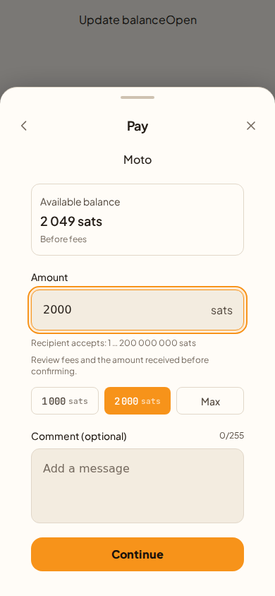
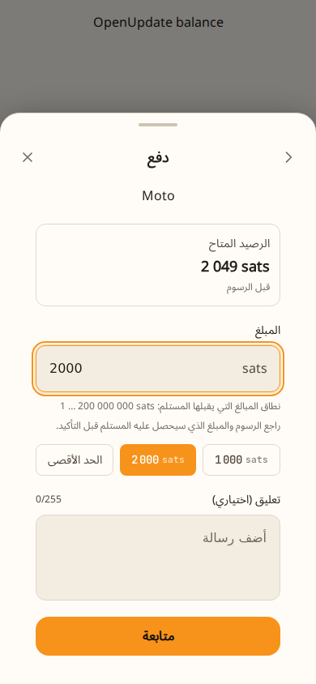
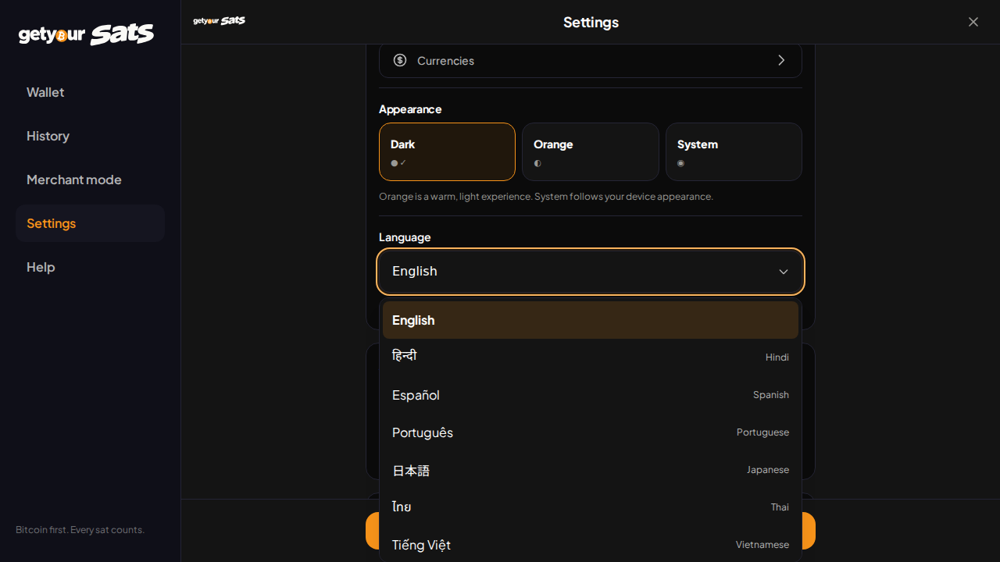

# Payment balance, language selection and wallet branding

Review date: 25 October 2026. Production source baseline: `afda630`.
Tested implementation commit: `250912b186fcf1e8172f19432f9df124087e0c02`.
Branch: `feat/payment-balance-locales-branding-20261025`.

## Decision

Ready for code and product review, with the release gates below still open. This is not a claim of complete app localization or wallet security certification. The separate security candidate in PR #35 is not included. No production merge, deployment, wallet migration or funded transaction was performed.

## Implemented behavior

| Area | Result |
| --- | --- |
| LNURL amount entry | Live BTC balance from the existing wallet context, labeled before fees. Active token balance is shown separately. Unknown balance and pending conversion prevent preparation. |
| Recipient constraints | One secondary range beneath the amount. Limits come from the recipient, with no new 1 BTC ceiling. A mocked 150,000,000-sat preparation succeeds when both balance and recipient permit it. This does not establish an external service's settlement capacity. |
| Maximum amount | Max retains the SDK's fee-inclusive policy and recipient cap. A falling balance invalidates a previously selected maximum. A balance below the recipient minimum has explicit feedback. |
| Language selector | Compact, searchable, keyboard-accessible dropdown with ten native language names and persisted selection. Existing onboarding selection also exposes the ten languages. |
| New locales | Japanese, Thai, Vietnamese, Tamil, Arabic and Simplified Chinese catalogs for navigation, home, wallet actions, payment UI and existing trust messages. Existing English, Hindi, Spanish and Portuguese remain. |
| Arabic | Root language/direction, desktop navigation placement, drawer and page animation direction, back/close placement, and isolated monetary/protocol data. |
| Typography | Self-hosted script fonts and Vietnamese character support. Script-font CSS loads on demand; font files use Unicode subsets. Font licenses are distributed with the site. |
| Brand copy | GetYourSats leads Bitcoin receiving copy. Spark architecture remains in an expandable explanation. Cross-chain introduction describes reviewing the route's actual asset/output rather than promising bitcoin for every route. Costs and deposit warnings remain visible. |

## Verification actually run

All browser scenarios use isolated local SDK doubles. They do not create a connected wallet, sign a payment or use user credentials.

| Command | Result |
| --- | --- |
| `npm test` | 98 files, 828 tests passed. Includes eight new balance/limit tests and twelve locale catalog/persistence tests. |
| `npm run build` | TypeScript and Vite production build passed. Existing ineffective dynamic-import warnings remain. |
| `npm run lint` | No errors; nine existing warnings. |
| `npx playwright test e2e/tests/payment-locales.spec.ts e2e/tests/getyoursats-desktop-navigation.spec.ts e2e/tests/getyoursats-review.spec.ts --config=.qa-playwright.config.ts --reporter=list` | 47 checks passed in local Chromium. |
| `git diff --check` | Passed before commit. |

The normal Playwright Chromium download failed in this environment. The actual browser run used a separately installed `@sparticuz/chromium` executable, with a temporary Playwright configuration overriding only the Chromium executable and launch environment. No additional browser package was added to the application. The committed tests run with the repository's normal Playwright configuration in CI. WebKit, Firefox and physical devices were not tested.

Responsive checks cover 360, 390, 768, 1,024, 1,366 and 1,920 px; navigation also covers phone landscape, reduced motion and a 200%-zoom-equivalent viewport. Payment layouts were checked in English, Arabic and Tamil at all six widths. Other script fonts have phone-width checks. The selector was exercised with keyboard search, persistence, Arabic-to-English direction reset and Arabic desktop/mobile Settings. Existing Settings-to-History navigation regression checks passed.

The initial built CSS is 30.69 KB compressed. The script-font CSS is a separate 88.86 KB compressed asset, downloaded when needed. A browser check verifies that a Latin-language payment fixture does not eagerly request script-font styles. These are build measurements, not a claim of measured real-device startup speed.

## Remaining release gates

1. **Native-language review:** Have native speakers review financial, recovery, removal and uncertainty wording in each new locale. These are initial authored translations, not professionally approved translations. Confirm Japanese and Chinese terminology, Thai and Tamil line wrapping, and Arabic reading order on actual devices.
2. **Full localization is incomplete:** Existing hardcoded English remains in advanced Settings/security explanations, generic send entry, some SDK errors and other legacy screens. The selector discloses partial translation. Do not market these locales as fully localized. Either complete those screens before a broad regional launch or explicitly release the new locales as preview support.
3. **Physical device/PWA pass:** Check current iOS Safari and installed PWA, Android Chrome/PWA and the native wrapper. Cover the numeric keyboard, scroll containment, safe areas, font cache/offline behavior, background/resume balance refresh, language switching and text enlargement. Local Chromium width emulation does not prove these behaviors.
4. **Operational review:** Review against the current production head before merge. Preserve the independent wallet-security release decision; passing these UI tests does not clear its gates. Real settlement was not required or performed for this UI change.

## Release and rollback

Keep this PR separate from custody or authorization changes. After review, publish a preview, run the device and language gates, then promote using the normal production process. Do not use a user wallet to validate a preview.

The change reuses the existing presentation-preference key and existing wallet data flow. It does not alter wallet secrets, identity, SDK connection configuration, transaction authorization or payment persistence. Rolling back to the prior application code leaves wallet data untouched; older code falls back to English for a newly selected locale it does not recognize. Retain hashed static assets through the ordinary deployment retention window so open tabs can finish loading their resources.

## Review screenshots

All balances and recipients below are disposable fixture data.

### English payment sheet

### Arabic payment sheet

### Compact desktop language dropdown

